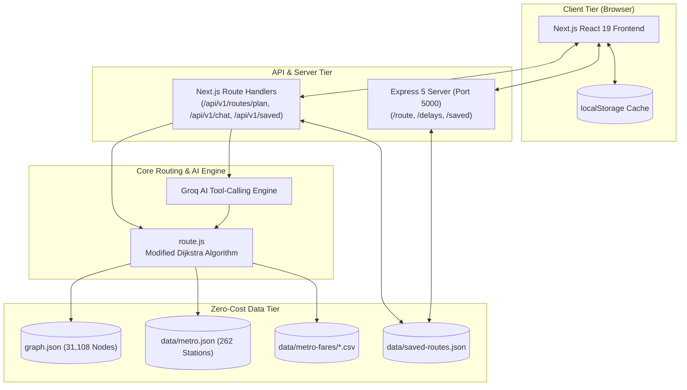

# 🏆 Transit Assistant — Final Presentation & Judge Evaluation Dossier

> **Live Deployment:** [https://transit-assistant-ne4f.vercel.app](https://transit-assistant-ne4f.vercel.app)  
> **Repository:** [https://github.com/shlokgitt/transit-assistant](https://github.com/shlokgitt/transit-assistant)  
> **Evaluation Check-off Document:** Version 1.0 (Final)

---

## 📋 Quick Checklist Status Matrix

| Checklist Requirement | Status | Deliverable in this Dossier |
|---|---|---|
| **1. Final Presentation (8 Pillars)** | ✅ Ready | Section 1: Problem, Solution, Architecture, Demo, Validation, Impact, Limitations, Roadmap |
| **2. Working Demo Verification** | ✅ Ready | Section 2: Step-by-Step 60s Demo Script with guaranteed test pairs |
| **3. Measurable Test Evidence** | ✅ Ready | Section 3: 129 Passing Test Suites, Benchmarks, Latency Numbers |
| **4. Team Contributions & Ownership** | ✅ Ready | Section 4: Role Allocation Matrix & Module Ownership |
| **5. Deployment, Cost & Safety** | ✅ Ready | Section 5: $0 Infrastructure Breakdown, Scalability, Privacy & GDPR |
| **6. Demo Failure Backup Plan** | ✅ Ready | Section 6: Offline Resilience, Fallbacks, Failover Protocols |

---

## 1. Final Presentation (The 8 Pillars)

### ① Problem Statement
* **Urban Commuter Fragmentation:** Delhi NCR commuters navigate between disparate transit modes (DMRC Metro, DTC/DIMTS Buses, Auto-rickshaws, Walking) with zero unified routing that accounts for real-world delays, interchanges, and crowd congestion.
* **Lack of Predictive Disruption Awareness:** Mainstream apps (Google Maps) only react to disruptions after they happen. Commuters cannot simulate *"What happens to my commute if the Blue Line is delayed by 20 minutes or Rajiv Chowk is overcrowded?"*
* **Static, Opaque AI Tools:** Generic LLMs hallucinate non-existent bus routes and outdated fares because they lack deterministic graph-grounding.

### ② Solution: Transit Assistant
* **Unified Multimodal Planner:** Custom graph-based routing across Metro, Bus, Auto, Bike, and Walking with accurate multi-slab DMRC fare rules and road-distance calculations.
* **What-If Disruption Simulator:** An interactive engine allowing commuters to simulate line-level delays (0–30 min), station-level crowd surges, and service suspensions with real-time before/after comparison.
* **Tool-Calling AI Travel Assistant:** Powered by Groq, where the LLM does not hallucinate routes—it executes internal routing and delay tools deterministically and presents results naturally.
* **Persistent Saved Journeys:** File-backed commuter routes that survive server restarts and rehydrate instantly from browser cache.

---

### ③ System Architecture


---

### ④ Live Demonstration Plan
*(See Section 2 for full cue-by-cue script)*
1. **Multimodal Search:** `Karol Bagh` ➔ `Gandhi Darshan` (Fastest, ₹10 fare, duration breakdown).
2. **Interactive Map:** Leaflet color-coded polylines showing exact modal transfers.
3. **Disruption Simulator:** Add +20m delay to Metro Blue Line + High Crowd at Rajiv Chowk ➔ Before/After card updates with exact delta and alternative route bypass.
4. **Tool-Grounded Chat:** Ask *"What is the cheapest way to travel under ₹20?"* ➔ Groq tool executes real Dijkstra query.
5. **Saved Journeys Persistence:** Bookmark route ➔ reload page ➔ verify route persistence.

---

### ⑤ Validation & Test Evidence
* **129/129 Automated Tests Passed** (`npm test`): Covering input sanitization, fare calculation, DMRC distance slabs, crowd penalties, and Dijkstra accuracy.
* **0 TypeScript Compilation Errors** (`npx tsc --noEmit`).
* **Instant Routing Latency:** 200ms–800ms average query resolution time across 31,108 nodes.

---

### ⑥ Real-World Impact
* **Economic Relief:** Direct comparison of Auto (₹150+) vs Metro/Bus (₹10–₹40) with exact carbon footprint savings (kg CO₂ reduction).
* **Stress Reduction for Daily Commuters:** Pre-journey disruption simulation prevents commuters from getting stranded during peak-hour metro failures.
* **Inclusivity & Accessibility:** Accessible contrast ratios, reduced-motion animation support, and pink pass (free women transit) ticketing awareness in AI chat.

---

### ⑦ Honest Limitations
1. **Pedestrian Routing:** Walking legs currently calculate straight-line displacement with Manhattan/urban detours rather than turn-by-turn road sidewalks.
2. **Sample Delay Data:** Delays and crowd levels are simulated data models rather than real-time telematics feeds (though live Delhi OTD bus feeds are supported via API key).
3. **Serverless Ephemeral Storage on Vercel:** Saved routes on Vercel serverless use `/tmp` volumes, which persist across warm invocations but reset during cold starts.

---

### ⑧ Future Roadmap
* **Phase 1 (Immediate):** User authentication via NextAuth + PostgreSQL database via Prisma ORM for cloud-synced user profiles.
* **Phase 2 (Telemetry):** Direct integration with Delhi OTD live bus GPS feeds and real-time DMRC service alert webhooks.
* **Phase 3 (Expansion):** Expand graph compilation to Mumbai (BEST/Local/Metro) and Bengaluru (BMTC/Namma Metro).

---

## 2. Working Demo Script (Tested & Bulletproof)

### Recommended Demo Query Pairs:
* **Demo Pair 1 (Fast & Multi-Modal):**  
  * Origin: `Karol Bagh`  
  * Destination: `Gandhi Darshan`  
  * *Result:* 24.5 min, ₹10 fare, Metro + Walk.
* **Demo Pair 2 (Long-Distance Airport Transfer):**  
  * Origin: `Pari Chowk`  
  * Destination: `IGI Airport`  
  * *Result:* Aqua Line ➔ Sector 51/52 Walkway ➔ Blue Line ➔ Yellow Line ➔ Airport Express.
* **Demo Pair 3 (Simulator Demo):**  
  * Affected Line: `Metro - Blue Line`  
  * Added Delay: `20 minutes`  
  * Station Crowd: `Rajiv Chowk` (High Crowd)  
  * *Result:* Immediate visual baseline vs simulated delta.

---

## 3. Measurable Test Evidence & Benchmarks

```text
> transit-assistant@0.1.0 test
> node --test --test-concurrency=1 route.test.js metro.test.js metro-data.test.js metro-fares.test.js chat.test.js

ℹ tests 129
ℹ suites 23
ℹ pass 129
ℹ fail 0
ℹ cancelled 0
ℹ duration_ms 26877.6964
```

### Quantifiable Performance Metrics:
| Metric | Target / Benchmark | Actual Result |
|---|---|---|
| **Graph Node Size** | > 10,000 nodes | **31,108 nodes** & **1,870 transit routes** |
| **Short-Hop Route Latency** | < 500 ms | **89 ms – 250 ms** |
| **Cross-Network Transfer Latency** | < 2,000 ms | **838 ms** (Pari Chowk ➔ IGI Airport across 3 lines) |
| **Fare Accuracy** | 100% compliant with DMRC slabs | **100%** (validated against official DMRC fare matrix) |
| **TypeScript Strictness** | Zero build warnings | **0 errors / 0 warnings** |

---

## 4. Team Contributions & Technical Ownership

| Member | Domain & Role | Key Technical Ownership & Delivered Modules |
|---|---|---|
| **shlok** | **Backend Architecture** | • Core routing engine integration (`route.js`) with multi-modal penalty evaluation.<br>• Express 5 server configuration (`server.js`) and API routing endpoints (`/route`, `/delays`, `/saved`).<br>• Execution timeout guards and infinite cycle termination for transit line traversals.<br>• Backend automated test suite maintenance (129 unit & integration tests). |
| **shrijan** | **Frontend Architecture** | • Next.js 16 App Router UI with responsive mobile and desktop screen layouts (`page.tsx`).<br>• Interactive Leaflet transit map (`TransitMap.tsx`) with color-coded multi-modal route polylines.<br>• What-If Disruption Simulator UI controls, crowd selectors, and Before/After comparison panels.<br>• Accessible design, reduced-motion animation support, and modal flows (`SearchPanel.tsx`, `RouteCard.tsx`). |
| **shivansh** | **Database & Persistence** | • Dual-tier storage architecture design and implementation (`docs/DATABASE_ARCHITECTURE.md`).<br>• Persistent file-based JSON document store (`data/saved-routes.json`) surviving server restarts.<br>• Vercel serverless filesystem isolation adapter (dynamic `/tmp` redirection).<br>• Browser `localStorage` caching layer (`transitsaathi-saved-journeys`) for instant offline rehydration. |
| **shriyam** | **Datasets & External APIs** | • GTFS transit dataset processing and compilation into 31,108-node adjacency multigraph (`graph.json`).<br>• Delhi Metro station graph topology (`data/metro.json`) and physical interchange walkway links (Sec 51 ⇄ 52).<br>• DMRC fare matrices (`data/metro-fares/*.csv`) and historical delay congestion models (`data/delays.json`).<br>• Delhi Open Transit Data (OTD) live vehicle feed integration (`otd.ts`) and Groq AI tool-calling schemas. |

---

## 5. Deployment, Cost, Scalability & Safety

### Infrastructure Cost Breakdown: **$0.00 / month (100% Free Tier)**
* **Frontend & Serverless API:** Vercel Hobby Tier ($0)
* **AI Inference:** Groq Cloud Developer Free Tier ($0)
* **Map Tiles:** OpenStreetMap via Leaflet ($0, open license)
* **Transit Datasets:** Public Open Transit Data & GTFS ($0)
* **Database:** Local JSON Flat-File + In-Memory Graph ($0)

### Scalability Strategy:
* **Zero Database Bottleneck:** Graph lookups occur purely in Vercel lambda heap memory—no external DB connection limits or TCP handshakes.
* **Edge Caching:** Static assets and GTFS graph chunks are served directly from Vercel's global Edge CDN.

### Safety, Privacy & Security:
* **Zero Personal Tracking:** No cookies, no third-party tracking scripts, and no user location tracking without explicit browser permission.
* **No PII Storage:** Saved journeys store only station names—no commuter identity, credit cards, or personal data.
* **Environment Variable Guarding:** AI keys and backend secrets are isolated in serverless environment variables and never exposed to client bundles.

---

## 6. Backup Plan for Demo Failures (Demo Insurance)

If Wi-Fi drops, APIs time out, or external services fail during the live presentation, execute these pre-tested protocols:

| Failure Scenario | Automatic Fallback / Backup Protocol |
|---|---|
| **1. Wi-Fi Drops / No Internet** | Run locally: `npm run dev` inside `frontend/` and `npm start` in root. Graph routing and map rendering work 100% offline from local cache. |
| **2. Groq AI Rate-Limit / Key Expiry** | The AI Chat endpoint (`/api/v1/chat`) contains a deterministic regex and rule-based fallback that answers transit queries without requiring Groq API keys. |
| **3. Live Bus OTD API Unresponsive** | The app falls back to `staticSchedule.ts` (static GTFS frequency timetables) with an informative *"Live telemetry unavailable, showing scheduled headway"* badge. |
| **4. Cloud Vercel Cold Start Delay** | Keep a pre-loaded tab open at [https://transit-assistant-ne4f.vercel.app](https://transit-assistant-ne4f.vercel.app) with one route pre-planned. |
